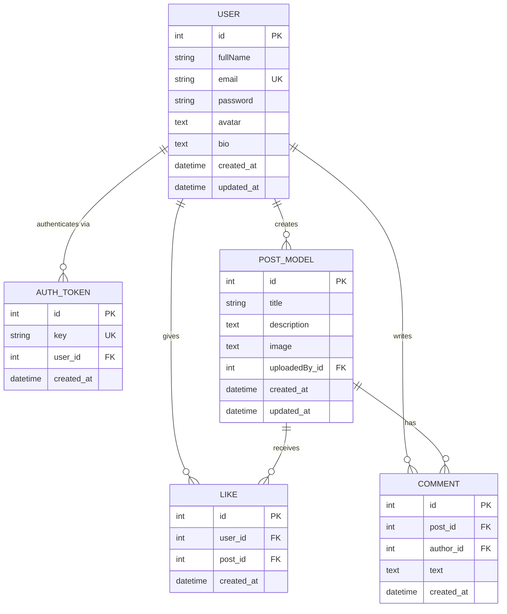

# GatherUp — Database Schema & ER Diagram

This document describes the relational database schema for **GatherUp** (SQLite in development, compatible with PostgreSQL/MySQL via Django ORM).

## Entity-Relationship Diagram

---

## Tables & Constraints

### 1. `UserApp_user` (`User`)
Stores registered user accounts and profile metadata.

| Column | Type | Constraints | Description |
| :--- | :--- | :--- | :--- |
| `id` | Integer | Primary Key, Auto-increment | Unique user identifier |
| `fullName` | `VARCHAR(100)` | Not Null | User's display name |
| `email` | `VARCHAR(254)` | Unique, Not Null | Normalized lowercase email |
| `password` | `VARCHAR(255)` | Not Null | PBKDF2-hashed password (`make_password`) |
| `avatar` | `TEXT` | Blank allowed | Profile image URL |
| `bio` | `TEXT(500)` | Blank allowed | Short user bio |
| `created_at` | `DATETIME` | Auto-set on insert | Account creation timestamp |
| `updated_at` | `DATETIME` | Auto-set on update | Last profile update timestamp |

### 2. `UserApp_authtoken` (`AuthToken`)
Stores bearer/token keys issued on registration and login.

| Column | Type | Constraints | Description |
| :--- | :--- | :--- | :--- |
| `id` | Integer | Primary Key | Token record ID |
| `key` | `VARCHAR(64)` | Unique, Indexed | 64-char hex token (`secrets.token_hex(32)`) |
| `user_id` | Integer | Foreign Key → `UserApp_user.id` (`CASCADE`) | Token owner |
| `created_at` | `DATETIME` | Auto-set on insert | Token issue timestamp |

### 3. `PostApp_postmodel` (`PostModel`)
Stores user-published posts ordered newest first (`-created_at`).

| Column | Type | Constraints | Description |
| :--- | :--- | :--- | :--- |
| `id` | Integer | Primary Key | Unique post identifier |
| `title` | `VARCHAR(150)` | Not Null | Post headline |
| `description` | `TEXT(2000)` | Not Null | Post caption / body |
| `image` | `TEXT` | Blank allowed | Optional post image URL |
| `uploadedBy_id` | Integer | Foreign Key → `UserApp_user.id` (`CASCADE`) | Post author |
| `created_at` | `DATETIME` | Auto-set on insert | Creation timestamp |
| `updated_at` | `DATETIME` | Auto-set on update | Last edit timestamp |

### 4. `PostApp_like` (`Like`)
Join table implementing a **Many-to-Many** relationship between `User` and `PostModel`.

| Column | Type | Constraints | Description |
| :--- | :--- | :--- | :--- |
| `id` | Integer | Primary Key | Like record ID |
| `user_id` | Integer | Foreign Key → `UserApp_user.id` (`CASCADE`) | User who liked |
| `post_id` | Integer | Foreign Key → `PostModel.id` (`CASCADE`) | Liked post |
| `created_at` | `DATETIME` | Auto-set on insert | Like timestamp |

- **Composite Unique Constraint:** `(user_id, post_id)` prevents a user from liking the same post more than once.

### 5. `PostApp_comment` (`Comment`)
Stores comments made by users on posts, ordered chronologically (`created_at`).

| Column | Type | Constraints | Description |
| :--- | :--- | :--- | :--- |
| `id` | Integer | Primary Key | Comment ID |
| `post_id` | Integer | Foreign Key → `PostModel.id` (`CASCADE`) | Target post |
| `author_id` | Integer | Foreign Key → `UserApp_user.id` (`CASCADE`) | Comment author |
| `text` | `TEXT(500)` | Not Null | Comment body |
| `created_at` | `DATETIME` | Auto-set on insert | Comment timestamp |
