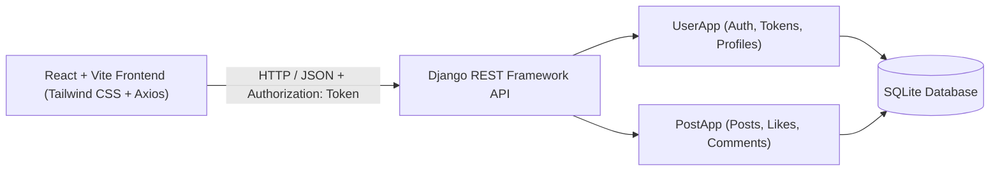

# GatherUp

A full-stack community social platform built with **Django REST Framework** and **React (Vite + Tailwind CSS)**. Users can register, authenticate via token-based auth, publish posts, search the feed, like and comment on posts, and manage their profiles.

---

## Key Features

- **Token-Based Authentication & Security**
  - Password hashing using Django's `make_password` / `check_password` (PBKDF2)
  - Unique email enforcement and 64-character hex `AuthToken` issuance
  - Protected write endpoints with `401 Unauthorized` and owner-only `403 Forbidden` checks
- **Community Feed & Search**
  - Real-time keyword search (`?q=`) across post titles, descriptions, and author names
  - Optimistic/live like toggling with unique per-user constraints
  - Expandable comment threads with owner-only comment deletion
- **User Profiles & Post Management**
  - View own or other members' profiles (`/profile`, `/profile/:id`) with post count and likes received
  - Inline profile editing (`fullName`, `bio`, `avatar`)
  - Create, inspect (detail modal), and delete posts

---

## Architecture



For the full relational schema and Entity-Relationship Diagram, see [DB_DIAGRAM.md](./DB_DIAGRAM.md).

---

## Tech Stack

| Layer | Technologies |
| :--- | :--- |
| **Backend** | Python 3.12+, Django 6.0, Django REST Framework 3.16, `django-cors-headers` |
| **Frontend** | React 19, Vite 7, Tailwind CSS 4, React Router DOM 7, Axios, Lucide React |
| **Database** | SQLite (via Django ORM) |

---

## API Endpoints

### User & Auth (`/api/userApp/`)

| Method | Endpoint | Auth Required | Description |
| :--- | :--- | :--- | :--- |
| `POST` | `/api/userApp/register` | No | Register a new user and return `{ user, token }` |
| `POST` | `/api/userApp/login` | No | Authenticate credentials and return `{ user, token }` |
| `POST` | `/api/userApp/logout` | Yes | Invalidate current auth token |
| `GET` | `/api/userApp/getProfile/<id>` | No | Fetch user profile and engagement stats |
| `PATCH` | `/api/userApp/updateProfile` | Yes | Update authenticated user's name, bio, or avatar |

### Posts, Likes & Comments (`/api/postApp/`)

| Method | Endpoint | Auth Required | Description |
| :--- | :--- | :--- | :--- |
| `GET` | `/api/postApp/allPosts?q=<query>` | Optional | List all posts (with optional search filter) |
| `GET` | `/api/postApp/postByUser/<user_id>` | Optional | List posts created by a specific user |
| `POST` | `/api/postApp/createPost` | Yes | Create a new post |
| `GET` | `/api/postApp/posts/<post_id>` | Optional | Retrieve a single post |
| `PATCH` / `DELETE` | `/api/postApp/posts/<post_id>` | Yes (Owner) | Update or delete a post |
| `POST` | `/api/postApp/posts/<post_id>/like` | Yes | Toggle like on a post |
| `POST` | `/api/postApp/posts/<post_id>/comments` | Yes | Add a comment to a post |
| `DELETE` | `/api/postApp/comments/<comment_id>` | Yes (Owner) | Delete own comment |

---

## Local Setup

### 1. Backend (Django)

```bash
# Create and activate a virtual environment
python3 -m venv .venv
source .venv/bin/activate

# Install Python dependencies
pip install -r requirements.txt

# Apply database migrations
cd backend
python manage.py migrate

# Start the development server (runs on http://localhost:8000)
python manage.py runserver
```

### 2. Frontend (React + Vite)

Open a new terminal in the project root:

```bash
cd frontend
npm install

# Ensure frontend/.env points to the Django server:
# VITE_API_URL=http://localhost:8000

npm run dev
```

The frontend will be available at `http://localhost:5173`.

---

## Running Tests

Run the Django unit and API test suite from the `backend/` directory:

```bash
cd backend
../.venv/bin/python manage.py test
```
